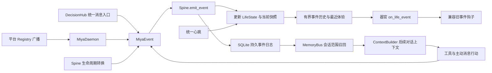

# 弥娅生命事件模型：事件、行动与记忆

本阶段把外部输入、平台连接和自身生命周期连接到同一条事件总线。
它提供统一上下文与可观察的连续状态，为记忆、需求、意图和行动反馈的后续整合建立接口。
这些工程状态并不证明主观意识，也不代表整个认知闭环已经完成。

第二阶段增加工具调用和主动投递的实际行动反馈、SQLite 持久事件日志，
以及通过 MemoryBus 和 ContextBuilder 进行的会话内经历召回。
第三阶段将明确约定保存为持续事项，关联真实行动、重启恢复、同会话情绪投影和受控跟进。

## 当前数据流



事件先更新状态并发布当前快照，再通知器官。消息无需等待下一次心跳即可被查询。
心跳和事件分发按序执行，避免旧的心跳快照覆盖新消息状态。
查询结果、事件历史以及各器官接收的事件快照均有独立副本，防止调用方改写共享体验。

## 事件协议

`core/miya_life_event.py` 定义 `MiyaEvent`：

| 字段 | 含义 |
| --- | --- |
| event_type | 稳定的事件类别 |
| source | 产生事件的平台或组件 |
| actor | 用户标识；保留平台 OpenID 等字符串 |
| payload | 类别专属数据 |
| timestamp | 事件时间，Unix 秒 |
| importance | 当前由入口给出的优先程度提示，尚未参与决策 |
| correlation_id | 关联线索；消息优先使用平台消息 ID，否则使用 M-Link ID |
| event_id | 每条事件的唯一 ID，用于持久化和事件重放去重 |

平台消息 ID 只应结合 source 和会话上下文解释，不假设不同平台之间全局唯一。
直接构造事件时默认生成随机关联 ID。同一 correlation_id 下可以存在多条独立事件；
总线按 event_id 去重，避免恢复或显式重放重复记账。
事件去重并不阻止调用方再次执行工具；主动投递仍使用已有的 delivery_id 幂等机制。

| event_type | payload | 旧钩子 |
| --- | --- | --- |
| user.message | message、user_id，以及入口提供的 message_id、group_id、message_type、sender_name | on_user_message(message, user_id) |
| action.started | action、action_id、kind、platform、user_id、group_id、message_id、delivery_id | 无 |
| action.result | action、result | on_action_result(action, result) |
| memory.recalled | event_ids 和明确的用户、平台、群聊范围 | 无 |
| intention.changed | intention_id、operation、完整事项快照和会话范围 | 无 |
| system.event | event、data（可为 None） | on_system_event(event, data) |
| platform.event | 原始平台广播，包含 event、platform_id、status、data 等 | on_system_event(event, data) |
| lifecycle.changed | old_phase、new_phase | on_lifecycle_change(old_phase, new_phase) |

所有器官先按 priority 接收 `on_life_event(event, state)`，再按 priority 接收对应旧钩子。
每个注册器官的每种钩子只调用一次；一个器官抛出异常不会阻止其余注册器官接收。
器官组转发新旧钩子。新钩子用于共享上下文，旧钩子继续承担已有行为；迁移时应避免两处重复执行同一行动。
钩子是同步、非阻塞接口；异步或耗时工作应通过现有后台任务机制安排。

## 生命状态

`MiyaSoulState` 保留原字段，并增加 `life_state: MiyaLifeState`：

| 字段 | 本阶段实际行为 |
| --- | --- |
| identity | 默认 miya |
| life_phase | 跟随脊柱生命周期转换 |
| attention | 最新用户消息的 actor、source 和最多 200 字符的内容摘要 |
| recent_experience | 最近 20 条事件的独立字典快照 |
| last_event_at | 最近接收事件的 timestamp |
| mood | 现有 Emotion 情绪谱叠加当前关注会话的近期事项证据；带来源 ID 和时间衰减 |
| needs | 当前关注会话的待办数、待核实数；尚不是完整需求引擎 |
| memory_focus | 最近一次经历召回的事件 ID |
| open_loops | 正在执行的行动调用，最多 50 条；结果到达后关闭 |
| last_action | 最新行动的 ID、名称及实际结果 |
| intentions | 最近更新的最多 50 个未收尾事项快照；完整记录按会话范围查询 |
| agency_budget | 默认 1.0，尚未接入自主行动配额 |

脊柱额外保留最近 200 条完整事件，可通过 `event_history` 查询。
`get_status()` 返回普通字典形式的 life_state，可用于 JSON 响应。
全局脊柱默认使用 `data/memory/life_events.sqlite3` 持久化事件。
单独构造 `MiyaSpine()` 时默认仍为内存模式，可显式注入 `event_journal`。
重启加载最近 200 条历史与最近 20 条体验，不重放钩子、不执行历史行动，
也不恢复旧会话的消息计数、关注点或调用级 open_loops。
持续事项由独立的 SQLite 投影表恢复，不受 200 条事件窗口影响；中断的执行标为待核实。
旧的 action.started 可以作为历史证据，但不会被当成仍在运行的任务。
日志写入失败会出现在 `get_status()["persistence"]` 并降级继续处理当前事件；
失败事件暂存最多 512 条，下一次事件与关闭时按原顺序补写，不重放钩子。
状态额外暴露 failed_writes、pending_writes、dropped_writes，成功写入不会抹去累计故障数。
暂存尚未落盘时遇到进程退出仍可能丢失；写盘仍在同步事件路径，尚未加入自动保留期限。

## 已连接的真实入口

1. `hub/decision_hub.py::process_perception_cross_platform` 在内部标志消息过滤后、快捷命令或普通响应处理前注入一次用户事件。终端、Web/API 和调用该入口的平台共用此接线。适配器自行处理且未进入 DecisionHub 的命令不在本次覆盖范围内。
2. `core/miya_daemon.py::_on_platform_broadcast` 注入 Registry 广播的连接、断开、重连、失败、错误和关闭等事件，保留原始字段。
3. `run/daemon.py::run_daemon` 在脊柱模式下提前创建总线，记录平台启动连接阶段的事件；器官注册后可从快照中的最近体验看到这些记录。关闭脊柱的模式不因事件接线而创建新脊柱。
4. `core/miya_spine.py::_transition` 产生生命周期事件。IDLE、DROWSY、SLEEP 收到用户消息后会安排恢复 RUNNING；后两者经过 WAKE 阶段。
5. 既有 `inject_action_result` 与 `inject_system_event` 改为统一总线适配接口，保持旧钩子数据格式。
6. `MiyaDecisionHubOrgan` 在生命事件到达时立即刷新缓存，同时继续接收统一心跳。
7. `ToolRegistry.execute_tool` 记录工具调用开始、权限或参数拒绝、结构化返回、异常、超时和取消。
   ToolAdapter 兼容路径也经过该注册表，恢复权限检查并避免异常后重复执行。
   DecisionHub/ResponseGenerator 工具上下文传递 request_id，与原消息事件关联。
8. `DecisionHub._dispatch_proactive_message` 在已有投递锁内记录一次实际投递尝试。
   相同 delivery_id 的成功或排队缓存命中不再产生新行动；明确失败后的重试生成新的 action_id，
   并保留同一 delivery_id 关联。调用取消时，已确认发送的结果继续保留，其余记为 cancelled。
9. `take_pending_proactive_messages` 记录 claimed，表示队列消息返回给领取方；
   它不是用户阅读或播放确认。

## 行动结果与记忆边界

工具结构化的 success、ok、status、error 优先用于判定。
普通说明文本仅记为 completed / success=null，表示调用已返回；
异常和明确错误前缀才记为失败，避免对“没有错误”等文字做任意关键词推断。
超时和取消都可能发生在外部副作用之后，因此 success=null，不声称操作一定未发生。
工具参数不写入生命日志；结果摘要最多 1000 字符，错误最多 500 字符。

主动投递区分 sent、queued、failed、rejected；排队接受的 success=null。
每个投递尝试结束就关闭调用级 open_loop，离线消息继续由原有队列管理。
现阶段覆盖主动投递与经过 ToolRegistry 的工具；各适配器独立发送的普通回复、
绕过注册表的工具，以及用户实际阅读确认尚未统一接入。
主动投递的消息内容仍由原有 MemoryManager 在发送或领取后写入对话记忆，
生命日志不再次伪造一条助手发言。

`MemoryBus.recall_experiences` 读取日志中的实际 action.result；
`ContextBuilder` 为后续对话加入最多 3 条行动回执，并更新 memory_focus。
召回必须精确匹配原始用户 ID、平台、群聊和显式会话，匿名或 unknown 平台不做全局回退。
默认会话别名经 ContextIdentity 归一为空会话；旧日志迁移后只属于默认会话。
有当前输入时在最近 100 条同范围候选中按中英文词项匹配，最多返回 3 条相关回执。
尚未进行向量语义召回。没有当前输入的查询保留按时间召回兼容行为。
此处尚未展开跨平台身份别名；面向群的主动投递归属 global，
因此不会作为某个具体用户的私人行动经历召回。
回执通过带来源 ID 的上下文数据提供，并明确区分“返回完成”和“外部效果确认”。
事项和回执以标记过的 user 数据消息提供，不再获得 system 角色权限；JSON 不作字符截断。
每个消费者最多 900 token 的经历预算，并为近期对话保留大部分容量。

## 持续事项、情绪与跟进

`manage_intention` 在正常及精简工具集均可见。明确约定通过 remember 保存，
list 查询，resume 关联新的来源请求，pause/abandon 暂停或结束。
confirm 完成、retry 核实后重试都需要引用当前用户输入的原文，不能用工具参数替代来源消息。
工具调用由模型选择，不会从所有自然语言承诺中自动、强制提取事项。

同一个用户/平台/群聊/显式会话内，只有本请求中指定确切 action_name 的唯一事项才自动关联工具。
调用级 open_loops 与事项级 intentions 分开：调用结束后，事项可以继续等待或核实。
仅 action_success 模式下的明确 success=true 自动完成；默认 user_confirmation 模式仍等待用户确认。
排队和领取是等待状态；超时、取消、普通文本返回是待核实状态，不能被自动重试。
事件和事项投影在同一个 SQLite 事务中提交；同源重复 remember 及事件重放不会重复创建事项或计数。
旧 PendingIntent、主动续聊 IntentState、TaskPlanner 与定时任务仍分别管理各自执行机制，
本层保存跨调用的约定事实，复用现有工具执行、Emotion 和 ProactiveCoordinator。

`Emotion.get_experience_state()` 在原情绪谱上投影明确结果：成功轻微提升 joy，失败轻微提升 sadness。
幅度有上限，按 6 小时时间常数衰减，24 小时后不再叠加；查询不会反复累计染色。
未知结果不会被推断成失败。证据保持在原会话范围，基础人格与基础情绪不被改写。
ContextBuilder 将事项证据与情绪投影同时供给回复和灵魂分析；决策器官把当前关注范围投影到共享 mood。
此阶段是可追溯的短期陪伴状态，尚未实现长期关系学习或自由生成的反思策略。

`MiyaContinuityOrgan` 由现有心跳驱动，每分钟最多检查一次；用户交互后至少安静 60 秒。
仅 follow_up=true 的事项会主动跟进，最早 30 分钟后，经统一协调器的静默、限频、去重和人格表达判断。
每次约定/明确恢复最多两次实际尝试；策略跳过只延期，不耗尽次数。配额状态未持久化，但事项跟进次数已持久化。
每次尝试先持久化预留，发送前和重试前复核事项版本及是否有新交互，避免暂停后继续发送旧提醒。
跟进固定原平台和原目标，离线时不切换到另一个平台；排队不等于送达，跟进送达也不等于原事项完成。
跟进只询问或报告已有进度，不自动重放外部工具。现有投递端还没有显式会话路由能力，提醒按平台和目标投递。

同时修复器官组内的启动绑定、异常与副本隔离；观测台使用独立 last_heartbeat_at，
用户事件刷新快照不再掩盖停止的心跳。

## 后续边界

普通回复的完整投递回执、跨平台身份别名召回、所有旧意图来源的适配、
显式会话的主动投递、异步单写入日志与归档、长期反思和关系学习仍待继续整合。

## 验证

```powershell
.venv/Scripts/python.exe -m pytest tests/test_miya_continuity.py tests/test_miya_action_memory.py tests/test_miya_life_core.py tests/test_soul_state.py tests/test_spine_lifecycle.py tests/test_proactive_delivery.py tests/test_proactive_coordinator.py tests/test_qq_official_parity.py tests/test_observatory.py tests/test_daemon_logs_tool.py tests/unit/test_memory_context_unification.py -q
```

测试覆盖状态立即发布、新旧钩子兼容、匿名用户、历史边界、快照隔离、错误隔离、
真实 DecisionHub 入口和平台 Registry 广播、启动连接记录、未启用脊柱的回退、
生命周期变更、休眠唤醒以及心跳与多线程消息并发。
第二阶段测试还覆盖持久恢复、事件 ID 去重、精确会话隔离、工具拒绝与异常、
工具自身 TypeError 后只执行一次、超时与取消传播、投递幂等、
排队与领取结果、真实记忆上下文召回以及磁盘或反馈故障时的主流程兼容。
测试日志统一写入 pytest 临时目录，不向弥娅的真实日志注入虚构经历。
第三阶段另覆盖约定失败后重启续接、真实 Registry 结果驱动完成、用户确认原文、
超时/取消核实、执行中暂停及迟到回执、同会话情绪衰减、相关召回和上下文预算、
受控跟进的静默/配额/新消息复核、原平台边界、累计次数恢复、日志补写事务和心跳健康。
