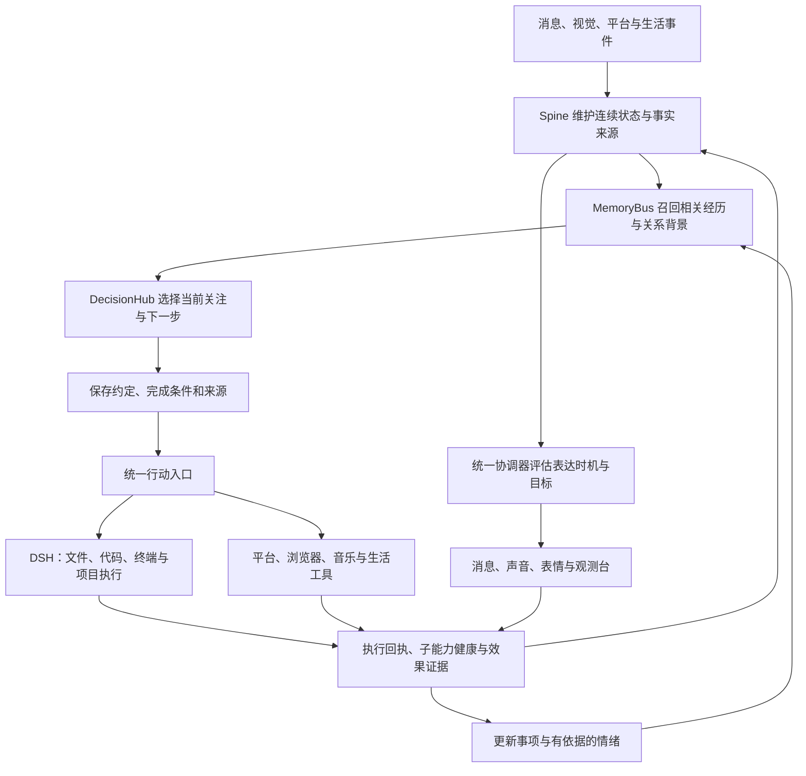

# 弥娅系统与 DSH 协调检查 · 2026-11-15

本次检查面向“持续存在、保持连贯、能主动行动并记住结果”的工程目标。结论：最近的生命事件、持续事项、行动回执、视觉状态和统一主动协调器已经建立了可用基础；目前最影响整体体验的是模块边界的语义不一致、持续事项没有在实际使用中建立起来，以及生命周期阻断跟进。应先修这些连接，再增加自主规划能力。

**范围与证据**

- 检查当前工作区，包含已暂存、未暂存和未跟踪的近期修改；核对提交 `a8176b7`、`255ca5f`、`3376685` 的相关实现。
- 索引主项目核心、平台、记忆、工具、服务和前端目录，沿启动、输入、上下文、工具执行、生命回执、事项投影与主动投递路径追踪。没有逐行审计全部第三方依赖或 DSH 上游源码。
- 只读查询 `data/memory/life_events.sqlite3`，查看本地守护进程日志，并用 Node 原生 Zstandard 解压读取 DSH 会话事实；没有重放历史任务。
- 两批现有回归测试共 **355 项通过**；另外执行最小诊断，复现上下文丢失、增强控制器分发空转、回执误判、跟进阶段冲突和模型地址遗漏。
- 本轮在检查后继续完成了第一批可靠性修复；改动范围与验证结果见文末。未安装依赖、未启动第二个守护进程、未新增真实模型调用。诊断使用 mocks 或临时目录，没有写入真实生命事件库。
- 测试通过表明所覆盖场景保持稳定；DSH 服务测试主要模拟子进程，不等于真实 CLI、MCP 子服务和 Python 环境已经一起验收。

**本轮已修复**

- 结果解析现在保留超时、取消和排队状态；MCP 适配器的传输失败文本也会落为失败。DSH stderr 独立返回，不会因普通警告抹掉结果；正常退出只说明 agent turn 完成，业务效果保持待核实。
- 将 DSH headless Mineradio 服务所需的 `mcp` SDK 加入基础依赖清单，并把解析出的 `DEEPSEEK_BASE_URL` 传给子进程。
- 到期事项可在 DROWSY/SLEEP 阶段进行受限跟进；最近交互保护、协调器限频与 guard 仍然生效。
- Skill 未命中后继续走 MCP/注册表分派；未执行的工具不再记录为成功。没有投递通道时 `send_message` 会明确返回失败。
- ToolContext 补全平台、会话、事项、用户输入与行动 ID；注册表自动生成的行动/事项关联会传入执行工具和 DSH。

本轮尚未完成真实安装后的 Mineradio 子进程启动验收、能力健康探测，也未处理 DSH 不同 provider 的选择映射；相关结论不能从模拟测试推导。

**近期已接好的部分**

| 部分 | 当前实现与价值 | 仍需连接的地方 |
| --- | --- | --- |
| 生命事件 | 用户消息、平台状态、生命周期、工具调用与主动投递进入统一事件总线；事件与事项投影持久化 | 视觉事件仍主要属于独立视觉上下文，普通回复投递尚未全面统一回执 |
| 持续事项 | `manage_intention` 保存约定、来源和完成条件，支持暂停、恢复、核实与重启恢复 | 建立事项仍依赖模型选择工具；当前实际事项表为空 |
| 经历召回 | `MemoryBus` 与 `ContextBuilder` 把历史行动回执和事项放入后续对话，保持会话隔离与证据标记 | 结果摘要与结果判定仍会失真；目前是有限窗口的词项匹配 |
| 情绪 | 明确事项结果可以产生有来源、有限幅度、会衰减的情绪投影 | 依赖事项被建立并关联；观测台主要展示基础情绪 |
| 视觉 | 统一视觉上下文区分瞬时事件、持续状态、来源健康与过期状态；自主摄像头事件已接主动表达 | 尚未成为生命事件与持续事项的统一证据 |
| 主动性 | 多个来源共用协调器，已有静默、限频、去重与来源预算 | 器官自己的阶段限制可能在协调器之前就拦掉候选 |
| DSH | 重复终端、文件、代码入口正在归并；执行改为异步子进程，传递请求元数据并处理超时取消 | 子能力启动、行动归因、结果解释与任务恢复没有形成统一协议 |
| 状态所有权 | 移除独立 `miya-soul` 子进程，保留主程序的 Spine、Emotion、MemoryBus | 部分兼容路径仍有独立工具实例和字段过滤规则 |

这些是现有工作值得继续建设的基础。无需另建一套“灵魂总控”覆盖它们。

**1. 优先修复：DSH 执行结果、子能力健康与生命记录混在一起**

代码位置：[DSH 返回值](D:/MiyaFactory/Miya/mcpserver/dsh/service.py:194)、[生命结果判定](D:/MiyaFactory/Miya/core/miya_action.py:17)、[Mineradio 服务导入](D:/MiyaFactory/Miya/mcpserver/miya_mineradio/server.py:9)。

DSH 服务以进程退出码确定 `success`，同时把全部 stderr 放进 `error`。生命层先检查非空 `error`，因此 `success=true` 也会被转换为 `failed/false`。

运行证据：2026-11-15 13:43:16 和 13:49:14 的两条 `mcp_dsh_execute` 行动回执，摘要内的服务结果均以 `success=true` 开始，生命日志的结果却均为 `success=false`。通过原始请求关联 ID 在压缩会话中定位，两次 DSH 会话的 `turn/end` 都是 `completed`，分别包含 7 次和 12 次工具调用。

这里的 stderr 还包含真实的子服务启动异常，不能简单全部忽略。当前 headless 配置指定 `.venv/Scripts/python.exe -m mcpserver.miya_mineradio.server`；用该解释器导入 `create_server` 实际报 `ModuleNotFoundError: No module named 'mcp'`。因此可确认：DSH 会话完成，音乐子服务启动失败。会话完成本身仍不证明所有外部任务目标已达成。

本轮已把 `stdout`、`stderr` 和 `execution_status` 分开，并把 `mcp` 加入基础依赖；成功的 DSH turn 不会自动记为业务成功。真实安装后的 Mineradio 启动检查、能力健康字段与健康页仍待补齐。

**2. 优先修复：DSH 超时在回到生命层后失去不确定性**

位置：[DSH 超时返回](D:/MiyaFactory/Miya/mcpserver/dsh/service.py:196)、[结果判定优先级](D:/MiyaFactory/Miya/core/miya_action.py:30)、[事项结果投影](D:/MiyaFactory/Miya/core/miya_intention.py:151)。

DSH 捕获超时并返回 `success=false/status=timed_out/error=...`，不是向注册表抛出超时异常。`tool_outcome` 优先命中 `success=false` 或 `error`，把它转换为 `failed/false`，后面的超时分支不会执行。最小诊断已复现。

关联事项因此可能进入普通失败的等待状态，而不是需要核实的状态。外部副作用可能已经发生，必须保留 `timed_out` 与 `success=null` 的业务含义。异常方式超时已有测试，返回 JSON 方式超时还需要贯通测试。

同一判定函数也未识别 MCP 适配器返回的 `MCP 调用失败:` / `MCP 调用异常:` 前缀，最小诊断得到 `completed/success=null`。应统一结构化错误，避免每层自行猜字符串。

**3. 优先修复：持续跟进的时间与生命周期互相冲突**

位置：[事项间隔](D:/MiyaFactory/Miya/core/miya_intention.py:13)、[空闲阶段阈值](D:/MiyaFactory/Miya/core/miya_spine.py:68)、[跟进阶段检查](D:/MiyaFactory/Miya/core/miya_continuity_organ.py:24)。

默认最早跟进时间为事项建立后 1800 秒；用户无交互 300 秒后进入 DROWSY，1800 秒后进入 SLEEP。跟进器官在检查、实际跟进和发送前复核三个位置，都只接受 RUNNING / IDLE。

最小诊断中事项已经到期，但 DROWSY 快照不会触发轮询或调度。因此，用户离开后一直安静的典型场景无法依靠这个器官主动跟进。用户以后重新交互、系统暂时回到 RUNNING / IDLE 时，旧事项才可能再次获得机会；不能说所有跟进都永久失效。

本轮已允许 DROWSY/SLEEP 进入器官轮询、跟进和发送前复核；所有外发仍交由统一协调器执行静默、可达性、配额与去重检查。覆盖了休眠态到期跟进，但尚未用完整 31 分钟虚拟时钟贯穿启动到发送。

**4. 优先修复：增强工具分发可以没有执行却报告完成**

位置：[Skill 分派](D:/MiyaFactory/Miya/core/gestalt_enhanced.py:628)、[默认返回](D:/MiyaFactory/Miya/core/gestalt_enhanced.py:717)。

当 SkillManager 与 SkillSandbox 存在时，`elif` 就被选中；即使查不到目标 Skill，也不会继续进入后面的 MCP 或 ToolRegistry 分支。随后默认返回“执行完成”，执行历史还记录成功。

最小诊断：请求 `mcp_dsh_execute`，Skill 查询返回空；注册表 await 次数为 0，返回“执行完成”，历史 `success=true`。

这是增强控制器路径的确定性问题。当前 OpenAI 主路径优先经过 ToolNet，不能据此断言所有 DSH 请求都被吞掉。本轮已改为只在找到 Skill 时消费请求，未匹配继续分发；工具返回明确失败标记时执行历史也记录失败。

同一个增强控制器的内置 `_tool_send_message` 只写日志并返回“消息已发送”，没有执行投递；本轮改为明确返回“不可用/未发送”，避免形成虚构行动证据。接入真实投递服务仍待后续实现。

**5. 兼容路径仍会丢失平台、会话和确认依据**

位置：[基础控制器字段白名单](D:/MiyaFactory/Miya/core/gestalt_controller.py:77)、[增强控制器字段白名单](D:/MiyaFactory/Miya/core/gestalt_enhanced.py:549)。

两个 `_build_tool_context` 都保留 `request_id/user_id`，却未保留 `platform/session_id/intention_id/message_id/channel_id/current_input`。最小诊断传入这些字段，转换后全部变成 `None`。

这会破坏明确平台、显式会话、事项关联和用户原话核实。现行 ToolSubnet 已使用 dataclass 字段进行上下文保留，主路径相对完整；问题主要留在兼容/回退路径。本轮已在两条兼容构造路径中保留上述字段与行动 ID；统一抽出单个构造器仍可作为后续维护优化。

还有一处关联断点：注册表为 `ActionFeedback` 生成的 `action_id`，以及自动匹配得到的 `intention_id`，没有再写入交给 DSH 适配器的上下文；适配器的元数据字段列表也不包含 `action_id`。本轮已将二者写回 ToolContext，并传入 DSH。关联 ID 的常规传递已有单测覆盖。

**6. DSH 模型配置只同步了部分信息**

位置：[模型选择](D:/MiyaFactory/Miya/mcpserver/dsh/config_bridge.py:61)、[配置写入](D:/MiyaFactory/Miya/mcpserver/dsh/config_bridge.py:138)、[子进程环境](D:/MiyaFactory/Miya/mcpserver/dsh/service.py:165)、[DSH 地址解析](D:/MiyaFactory/Miya/deepseek-harness/packages/llm/llm-deepseek/src/index.ts:185)。

桥接会解析 `base_url`，但写入 settings 时只更新 `agent-default-model`，启动子进程也未把解析的地址映射到 DSH 使用的 `DEEPSEEK_BASE_URL`。本轮已在配置结果与子进程环境中传递该地址，并有临时目录及子进程 mock 测试。

此外默认选择 `simple_chat`，并把 provider 固定成 `deepseek-official`。使用官方 DeepSeek 地址时可能正常；使用第三方兼容接口、本地模型或其他 provider 时，不能认为守护进程的模型选择被完整继承。手工设置 DSH provider 的注释，也与每次覆盖 `agent-default-model` 的行为不一致。

建议设立明确的执行任务模型配置，统一处理 provider、模型名、地址、凭据引用和能力校验；不要把复杂执行天然绑定到闲聊模型。

**7. “统一”仍有几个实际缺口**

- **工具实例**：[主程序](D:/MiyaFactory/Miya/run/main.py:305) 使用 `get_tool_subnet()`，而 [AIClient](D:/MiyaFactory/Miya/core/ai_client.py:36) 维护另一个惰性 `ToolSubnet()`。它们各有注册表、配置、调用统计与最后执行信息。请求上下文已补传部分组件，不能说第二个实例必然没有记忆或调度器；仍建议注入同一个运行时服务，避免展示目录和执行目录逐渐分化。
- **统计语义**：[ToolSubnet](D:/MiyaFactory/Miya/webnet/ToolNet/subnet.py:188) 把注册表正常返回视为成功，结构化失败和拒绝文本也会增加成功次数；MCPManager 的 success 又主要表示 handoff 正常返回。应明确区分传输成功、执行完成和业务效果。
- **主动信号**：[状态捕获](D:/MiyaFactory/Miya/core/miya_spine.py:385) 没有填写 `proactive/proactive_message`，[主动器官](D:/MiyaFactory/Miya/core/miya_proactive_organ.py:77) 却首先依赖它们。当前默认快照让这一分支没有真实触发源；其他 ProactiveChat、视觉和事项渠道仍可主动表达。应明确该分支的事件来源，或收敛到现行协调器。
- **需求和预算**：[生命状态](D:/MiyaFactory/Miya/core/miya_soul_state.py:35) 有 `agency_budget`，目前默认 1.0；`needs` 主要统计当前关注会话的待办和待核实事项。它们还没有成为跨器官选择行动的统一规则，不能只因为有字段就认为完整动机系统已运行。
- **经历与展示**：对话上下文使用事项结果投影后的情绪，[观测台](D:/MiyaFactory/Miya/core/observatory.py:100) 仍直接读取基础情绪。应显示清楚来源、范围与有效期，避免界面和对话表达看起来是两个状态。
- **执行连续性**：DSH headless 每次创建新 Agent/Session，Python 只等待最终 stdout；当前协议没有持久任务句柄、可恢复进度与面向用户的中途反馈。上游会话虽已落盘，弥娅并未把它映射成可继续的委托任务。

**实际运行快照的含义**

只读快照覆盖 2026-11-15 10:33:43 至 15:14:56，查询时有 206 条生命事件：53 条行动开始、53 条行动结果、61 条平台事件、28 条生命周期事件、9 条用户消息、2 条记忆召回。事项表 `life_intentions` 为 0，未出现 `intention.changed`。

这说明本地这段记录里“经历”已经流动，但新的持续事项机制尚未产生实际事项；它不能证明历史所有版本都没有持续意图，也不能据此统计整个系统的全部消息，因为普通回复和其他独立存储并不全在这张表里。

两次主进程委托 DSH 的耗时在日志中约为 34.52 秒和 194.18 秒。它们证明执行层实际参与了工作，同时说明长执行需要中途反馈。样本只有两次，不能据此推断整体成功率或平均耗时。

**建议的整合方式**



DSH 负责执行委托。弥娅主程序继续掌握身份、记忆、关系、情绪和当前目标。需要扩展的是清楚的委托与回执协议，不是恢复第二套灵魂状态服务。

感知事件不必把每帧图像或全部工具输出持久化；保留有来源、时效、置信度与范围的变化摘要。长期事项不需要替代每一个定时器或执行器，但应让这些执行器共享事项 ID、来源、状态与完成证据。

**实施顺序与验收**

1. **修通可靠性。** 处理 MCP 依赖与子服务健康，统一 DSH/生命结果，保留超时不确定性，修复增强分派和上下文。验收从真实可启动的 headless 组合出发，覆盖成功但带 stderr、子能力降级、超时、取消、拒绝与未匹配 Skill。
2. **让约定持续存在。** 在回复确认一项持续约定时保证实际保存；明确关联行动，补到期唤醒与投递回执。先适配重要旧意图来源，逐步接定时任务与地球任务。保持用户确认、事项范围和避免重复副作用的现有约束。
3. **让状态参与选择。** 用少量可解释需求与预算选择“关注什么、现在做什么、何时安静”；让视觉变化、未完成约定和近期经历成为共同输入。先复用协调器，不额外创建一组竞争后台循环。
4. **让经历改变后续相处。** 区分事实、推测、约定、偏好和关系变化；在真实结果后做有证据的反思。先让未来对话与选择稳定改变，再谈训练。当前检查没有验证 README 所述完整在线 RLHF 训练链路，不能把运行状态等同于模型权重已经更新。
5. **让表达反映同一个状态。** 消息、声音、Live2D 与观测台读取相同来源；能够解释“记着什么、正在做什么、为什么现在想说话”，并把实际发送结果回流。

优先完成三种可重复的陪伴验收：

- 佳约定一件事 → 确实保存 → DSH 执行 → 结果回流 → 后续能准确回答进度 → 重启后仍记得。
- 视觉检测到佳离开后回来 → 使用仍有效的观察证据 → 结合未完成事项和当前时间 → 协调器决定是否表达 → 留下真实投递记录。
- DSH 超时或音乐子能力离线 → 弥娅区分未知效果与能力故障 → 先核实已有结果 → 避免重复执行 → 能在用户同意继续后恢复。

“存在感”的可验收目标是：她记得共同经历，保持承诺与性格的连续性，能选择适当时机行动，能承认未知结果，并在重启或切换平台后继续相处。工程状态与这些行为可以验证；它们本身不是主观意识的证明。

**已执行的回归测试**

```powershell
.venv/Scripts/python.exe -m pytest tests/unit/test_dsh_coordination.py tests/unit/test_dsh_web_api.py tests/unit/test_platform_tools.py tests/unit/test_perception_quick_commands.py tests/test_miya_continuity.py tests/test_miya_action_memory.py tests/test_miya_life_core.py tests/test_soul_state.py tests/test_spine_lifecycle.py tests/test_proactive_delivery.py tests/test_proactive_coordinator.py tests/test_observatory.py tests/unit/test_memory_context_unification.py -q --tb=short
# 224 passed，33.90s

.venv/Scripts/python.exe -m pytest tests/unit/test_screen_vision_context.py tests/unit/test_screen_vision_proactive_wiring.py tests/unit/test_screen_vision_presence.py tests/unit/test_camera_frontend_contract.py tests/unit/test_camera_own_events_reach_proactive.py tests/unit/test_proactive_budget.py tests/unit/test_proactive_camera_triggers.py tests/test_ai_client_tool_args.py tests/test_daemon_logs_tool.py tests/test_qq_official_parity.py -q --tb=short
# 131 passed，20.40s

.venv/Scripts/python.exe -m pytest tests/test_miya_action_memory.py tests/test_miya_continuity.py tests/unit/test_dsh_coordination.py tests/unit/test_platform_tools.py -q
# 105 passed，18.80s
```

另执行的真实环境导入检查：

```powershell
.venv/Scripts/python.exe -c "from mcpserver.miya_mineradio.server import create_server; server = create_server(); print(type(server).__name__)"
# ModuleNotFoundError: No module named 'mcp'
```

现有测试出现 pytest-asyncio 配置、PyPDF2 与部分 utcnow 使用的弃用告警；不是本次核心断点。对本轮 Python 改动文件执行 Ruff 检查通过，`git diff --check` 通过。未执行全量测试、前端构建、带真实模型的新任务或全部平台端到端验收。`mcp` 依赖虽已声明，但当前环境未安装它，所以真实 Mineradio 启动结果仍是未验证。
